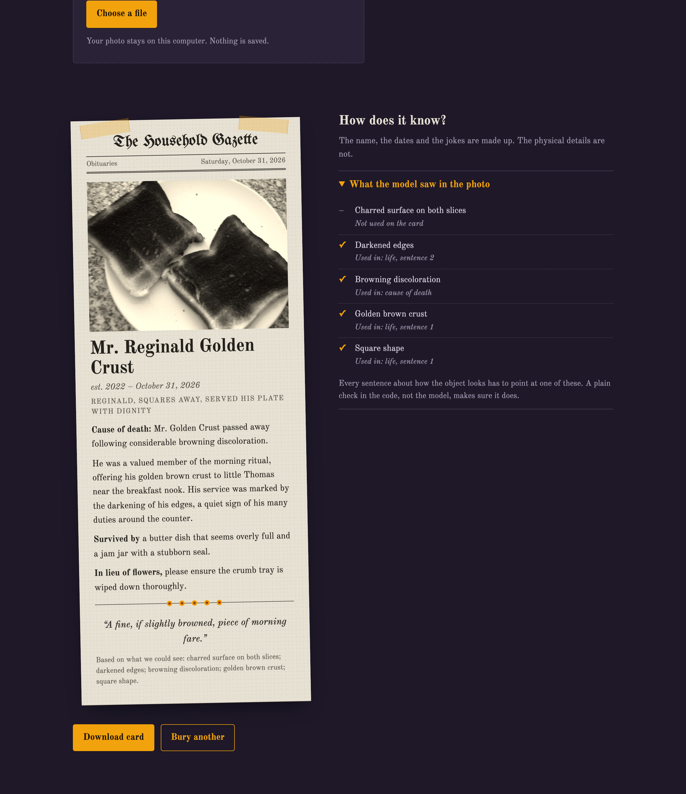
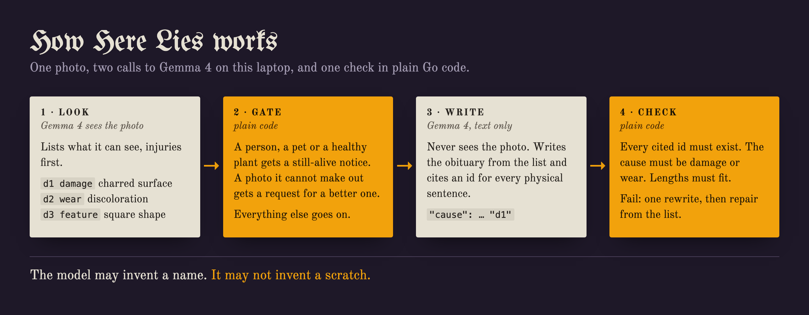

# Here Lies

Obituaries for the things that died in your house, written by a model on your own laptop.



Take a photo of something that died: a cracked phone, burnt toast, shoes with holes, last week's pumpkin. Gemma 4 runs on your computer through Ollama, looks at the photo and writes the thing a straight-faced newspaper obituary. The model may invent a name. It may not invent a scratch: every physical detail on the card has to point at something the model listed when it looked at the photo, and plain Go code checks that before you see it.

Point it at a cat, a person or a healthy plant and it refuses: "Still alive. Give it a treat instead."

Landing page: https://nazboyko.github.io/here-lies/

Read the story behind it on DEV: https://dev.to/nazar-boyko/here-lies-my-toaster-1nmm

## Run it

You need [Ollama](https://ollama.com), Go 1.26 and Node 20 or newer.

```
ollama pull gemma4:e4b
git clone https://github.com/nazboyko/here-lies && cd here-lies
make run
```

Then open http://localhost:8787. The server also prints an address for your phone on the same Wi-Fi, so you can photograph the deceased where it lies.

`HERELIES_MODEL` picks another Ollama model, `HERELIES_ADDR` another address.

## How it works



1. **Look.** Gemma 4 gets the photo and returns JSON: what the subject is (thing, person, animal, living plant, unclear), a name for the object, and what it can see, in three lists: damage, wear, features. Code numbers them `d1`, `d2`, ...
2. **Gate.** Plain code. A person, an animal or a healthy plant gets a still-alive notice. A photo the model cannot make out gets a request for a clearer one. Nothing else is written.
3. **Write.** A second call to Gemma 4, text only. The writer never sees the photo, only the numbered list. It returns the obituary as JSON, and every sentence about the body cites the ids it uses.
4. **Check.** Plain Go code, no model:
   - the cause of death cites an id that exists and is damage or wear (no damage seen at all: "Natural causes. It was simply no longer needed.");
   - every life sentence cites at least one id, and every id exists;
   - the name fits in 40 characters, sentences in 220, the epitaph in 12 words;
   - a soft check counts sentences that share no word with the detail they cite.

   A draft that fails goes back to the model once, with the problems listed. If the rewrite fails too, code keeps the sentences that pass and rebuilds the rest from the detail texts. The page says what it repaired.

The card footer always prints the details the model saw, so you can hold the obituary up against the photo yourself.

## Numbers

From [eval/results.md](eval/results.md): 17 photos from Wikimedia Commons, the real pipeline, `gemma4:e4b` through Ollama 0.35.1 on an Apple M5 Max with 64 GB.

| | |
|---|---|
| Gate decision correct | 16 of 17 |
| Obituaries printed | 13 |
| CHECK passed on the first draft | 12 of 13 (the other passed after one rewrite) |
| Details listed on printed obituaries | 65 |
| Details really in the photo, checked by eye | 53 true, 4 false, 8 unsure |
| Causes of death resting on a detail that is not there | 2 |
| Median seconds per step | 0.8 to look, 2.4 to write and check |

The miss at the gate: a blurred green glow that the model read as a flower and buried. The two false causes of death: a warped cassette adapter that "suffered a missing screw hole", and a collapsed umbrella with "torn fabric" that is not torn. CHECK can prove that each sentence points at a listed detail. It cannot prove the detail is real; that is the vision model's job, and the review above measures it.

## Privacy

- The browser shrinks the photo to 1024 px and re-encodes it, which drops the EXIF data (location included) before upload.
- The server keeps the photo in memory for one request. It never writes it to disk, keeps no database, and logs only the kind of answer and the timings.
- The page loads nothing from another host: fonts are bundled and the server sends a Content-Security-Policy that allows only itself. The browser test records every request during a full run and fails if one leaves the machine.
- With the model pulled, it works with Wi-Fi off.

## Tests

| command | what it runs |
|---|---|
| `make test` | `gofmt`, `go vet` and the Go unit tests: CHECK on fixture drafts, the gate, the repair step, the Ollama client against a fake server (bad JSON then retry, missing model, Ollama down, timeout), the HTTP routes |
| `make live` | every photo in `testdata/photos` through the real pipeline and the real model; writes `eval/run.json` |
| `make eval` | builds `eval/results.md` and `eval/results.csv` from the run and the by-eye review in `eval/review.json` |
| `make e2e` | Playwright against the real server and the real model: upload, card, PNG download, still-alive notices, phone width, keyboard, missing model, Ollama down, offline proof, the LAN address |
| `make shots` | the real cards and screenshots used in this README and on the landing page |

The test photos are listed in [testdata/SOURCES.md](testdata/SOURCES.md); the photos themselves are not in the repository.

## Limits

- The vision model makes mistakes the code cannot catch: it called the broken mug a "creamer jug" with a spout it does not have, and the drinking glass a vase. The footer shows its list, so you can see when it is wrong.
- One obituary at a time. On the M5 Max a card takes about 3 seconds; older laptops will be slower.
- English only.

## Credits

- [Gemma 4](https://ai.google.dev/gemma) by Google, under the Gemma Terms of Use, run through [Ollama](https://github.com/ollama/ollama) (MIT).
- [html-to-image](https://github.com/bubkoo/html-to-image) (MIT) turns the card into a PNG. [React](https://react.dev) and [Vite](https://vite.dev) (MIT) for the page.
- Fonts under the SIL Open Font License, bundled from [Fontsource](https://fontsource.org): Old Standard TT by Alexey Kryukov, UnifrakturMaguntia by j. 'mach' wust and Peter Wiegel.
- The Ollama request pattern (structured JSON output, timeouts, plain-language errors) comes from my earlier project [Backpack](https://dev.to/nazar-boyko/a-local-ai-reads-my-kids-school-papers-so-i-dont-have-to-2knk). The code here is new.

### Photo credits

Photos in the cards and screenshots, all from Wikimedia Commons:

| photo | author | license |
|---|---|---|
| [Old jack-o-lanterns](https://commons.wikimedia.org/wiki/File:Old_jack-o-lanters_(54177345952).jpg) | Giulia Forsythe | CC BY 2.0 |
| [Two pieces of burnt toast](https://commons.wikimedia.org/wiki/File:Two_pieces_of_burnt_toast.jpg) | Sheep purple | CC BY 2.0 |
| [Worn-out grey canvas shoes](https://commons.wikimedia.org/wiki/File:Worn-out_torn_shabby_hole-ridden_grey_canvas_shoes_light_soles_dirty_used_broken_laces_Utg%C3%A5tte_slitte_hullete_fillete_gr%C3%A5_t%C3%B8ysko_med_lette_gr%C3%A5_plasts%C3%A5ler_s%C3%A5ler_brukte_skitne_%C3%B8delagte_skolisser_Norway_2025_IMG_1772.jpg) | Wolfmann | CC BY 4.0 |
| [Homebase succulent rescue attempt](https://commons.wikimedia.org/wiki/File:Homebase_Succulent_Rescue_Attempt_(4526722760).jpg) | stephen boisvert | CC BY 2.0 |
| [Burnt light bulb on the ground](https://commons.wikimedia.org/wiki/File:Close-up_of_a_burnt_light_bulb_on_the_ground.jpg) | Shixart1985 | CC BY 2.0 |
| [MyPhone my27 front panel](https://commons.wikimedia.org/wiki/File:MyPhone_my27_front_panel.jpg) | JGBlue1509 | CC BY 4.0 |

The photos were turned gray for the newsprint look and placed on the card.

## About

Built for the DEV [Hacktoberfest Open-Source AI Challenge, Week 4: Ghost in the Machine](https://dev.to/challenges/hacktoberfest-week4-2026-10-26), on October 31, 2026. Halloween ends tonight and Día de los Muertos begins tomorrow: two nights for remembering the departed.

MIT license.

### Changes after the deadline

None.
